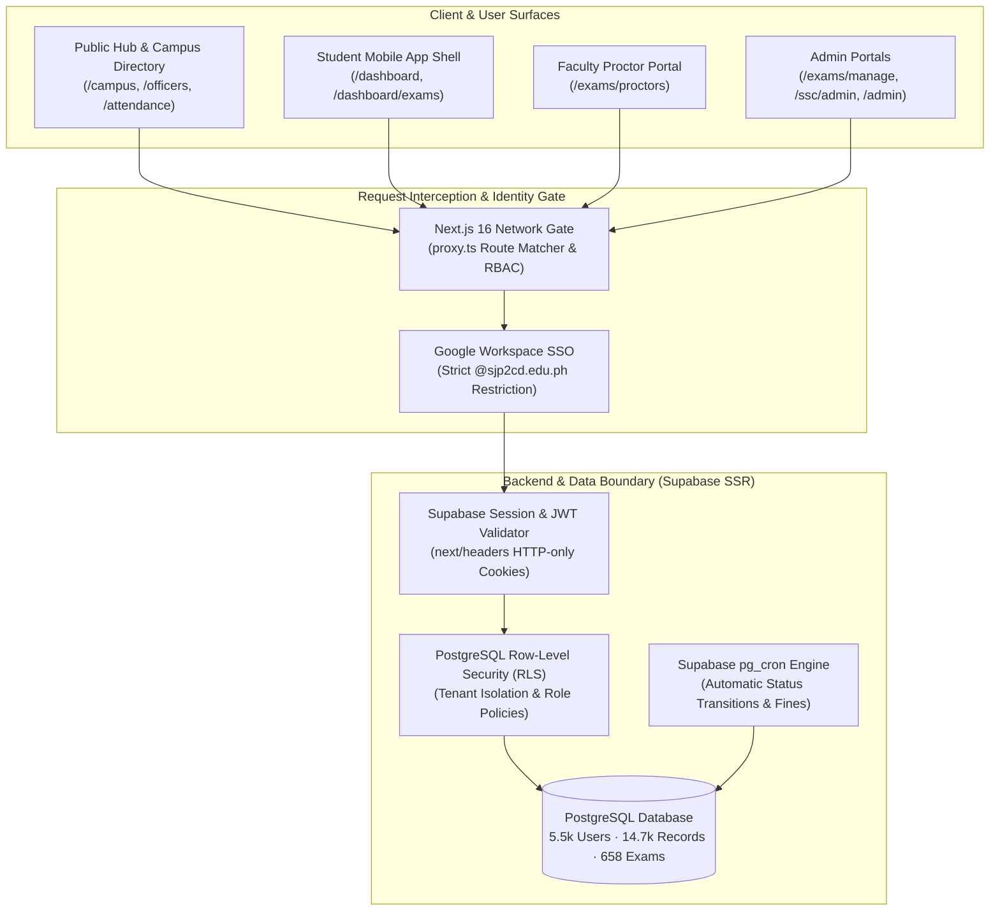

# Portfolio Case Study: JP Connect
**Institutional Student Services & Multi-Role Operations Platform**

* **Role:** Full-Stack Developer (Freelance)
* **Client / Institution:** St. John Paul II College of Davao (SJPIICD)
* **Deployment Timeline:** 2 Academic Semesters (Active in Production)
* **Live Scale:** 5,536 Authenticated Profiles · 14,778 Masterlist Records · 658 Exam Schedules · 107 Instructors
* **Tech Stack:** Next.js 16 (App Router, Turbopack, React Compiler), React 19, TypeScript (Strict), Tailwind CSS v4, Supabase (SSR, Auth, PostgreSQL RLS, pg_cron), Vitest, Playwright

---

## 1. Executive Summary & Impact Hero

### The Headline
> **Architected, engineered, and deployed an institutional web platform serving 5,500+ active university users across 3 administrative departments, replacing error-prone manual spreadsheets and paper queues with automated conflict detection, digital attendance passes, and cryptographically verified role-based access.**

### Key Performance & Scale Metrics (Live Production Data)
* **5,536 Registered Google SSO Users** across 2 active semesters (5,426 students, 107 faculty instructors, 3 admin portals).
* **14,778 Masterlist Student Records** ingested and dynamically mapped across 9 colleges and degree programs.
* **658 Departmental Exam Schedules** parsed and validated with zero schedule overlap collisions.
* **100% Automated 3-Way Conflict Detection** eliminating room double-bookings and instructor proctoring collisions.
* **Strict Type Safety & Zero `any`**: Built with Next.js 16, React 19, strict TypeScript, and end-to-end Vitest + Playwright regression suites.

---

## 2. The Problem & Institutional Context (The "Why")

Before JP Connect, operational workflows at St. John Paul II College of Davao (SJPIICD) relied on fragmented, manual, and unscalable processes across three key offices:

1. **The End-of-Semester Clearance Bottleneck (Supreme Student Council):**
   * Students had to physically line up for hours across campus to verify event attendance records, pay absentee sanctions, and collect physical clearance signatures.
   * SSC officers manually reconciled attendance from handwritten paper sheets and physical RFID log exports.
2. **The Departmental Exam Scheduling Matrix (Student Services Office):**
   * Department deans and schedulers submitted exam allocations in raw, unstandardized Excel spreadsheets.
   * Human schedulers spent days cross-referencing hundreds of time slots to detect **room double-bookings** or **instructors scheduled to proctor two different rooms at the exact same hour**.
   * Schedule revisions resulted in broken proctor assignments and misinformed students.
3. **Identity & Authorization Hazards:**
   * Student data privacy (under the Philippine Data Privacy Act of 2012) required strictly isolating student records so no student could inspect another's sanctions, status, or academic records.

---

## 3. High-Level Architecture & Defense-in-Depth Security

JP Connect was designed with a **Defense-in-Depth** security philosophy. No client-side state is ever trusted for authorization.

### The Two-Tier Security Boundary:
1. **The Front Door (`proxy.ts`):** Next.js 16 request interceptor verifies the session cookie, queries user role claims, and instantly redirects unauthenticated users or role mismatches (`super_admin`, `ssc_admin`, `exam_scheduler_admin`, `instructor`, `student`) before the page even renders.
2. **The Back Door (PostgreSQL Row-Level Security):** Even if an attacker bypassed the Next.js network layer, all database queries operate through Supabase client authenticated roles. PostgreSQL policies enforce that `auth.uid() = student_id`, preventing any unauthorized record extraction.

---

## 4. Three Deep Technical Engineering Highlights

### Deep Dive 1: The 3-Way Algorithmic Exam Conflict Resolver & Excel Parser
* **The Engineering Challenge:** The Student Services Office received complex Excel sheets with merged cells, varying time formats (`08:00 AM - 10:00 AM`), and disparate room names. Schedulers frequently introduced human error: scheduling two exams in Room 302 at the same time, assigning Instructor X to proctor two different exams concurrently, or assigning an instructor to proctor their own subject exam without authorization.
* **The Solution:**
  * Implemented safe, vulnerability-free spreadsheet parsing using `read-excel-file` (banning insecure legacy libraries).
  * Built an automated conflict-detection engine that runs temporal interval overlap algorithms:
    $$\text{Overlap} \iff (\text{Start}_A < \text{End}_B) \land (\text{End}_A > \text{Start}_B) \land (\text{Date}_A = \text{Date}_B)$$
  * The engine checks 3 distinct conflict types simultaneously:
    1. **Room Collisions:** Same room + overlapping time window.
    2. **Proctor Collisions:** Same instructor assigned to two separate rooms simultaneously.
    3. **Self-Proctoring Collisions:** Flagging instances where instructors are assigned to proctor their own classes when institutional policy mandates neutral proctoring.
* **Outcome:** 658 exam schedules ingested, parsed, and validated in seconds, flagging schedule collisions before publication to instructor and student portals.

---

### Deep Dive 2: Multi-Role RBAC & Defense-in-Depth Architecture
* **The Engineering Challenge:** Supporting 6 distinct authorization roles (`super_admin`, `osa_admin`, `ssc_admin`, `ssc_checker`, `exam_scheduler_admin`, `instructor`, `student`) with varying read/write privileges, while ensuring zero session leakages on shared school lab computers.
* **The Solution:**
  * **Zero Legacy Helpers:** Built with modern `@supabase/ssr` leveraging HTTP-only cookies and `next/headers`.
  * **Strict 1:1 Identity Binding:** During onboarding, the student signs in with Google SSO. The system matches their email against the registrar masterlist, confirms their inferred academic degree via `lib/course-mapper.ts`, and creates an immutable 1:1 binding between `auth.users.id` and the masterlist record.
  * **Server-First Execution:** 100% of sensitive queries and mutations are executed inside React Server Components (RSCs) and Server Actions with re-validated Zod schemas.

---

### Deep Dive 3: Real-Time Optical Attendance & Automated Sanctions Engine
* **The Engineering Challenge:** Eliminating physical clearance bottlenecks where thousands of students lined up to settle unexcused event absences.
* **The Solution:**
  * **Zero-Ping Client QR Pass:** Built an optical pass modal rendering dynamic SVG QR codes on-device via `qrcode.react`, paired with screen brightness enhancement and laser scanner animation for physical check-in desks.
  * **State Machine & Automated Background Processing:**
    * Attendance status progresses through a finite state machine: `pending` $\rightarrow$ `present` (upon scanner check-in) or `absent` (post-cutoff).
    * Configured automated PostgreSQL `pg_cron` jobs running every 5 minutes: after an event's cutoff time passes, all remaining `pending` records transition to `absent`, automatically calculating and attaching the institutional sanction fine.
    * Real-time SSC clearance status reflects instant settlement logging, allowing students to check their e-clearance status from their mobile dashboard without queuing.

---

## 5. Modern Frontend Architecture & UI/UX Standards

* **Next.js 16 + React 19 + React Compiler:** Built on the bleeding edge of the React ecosystem, eliminating manual `useMemo` / `useCallback` boilerplate through automatic React Compiler optimization.
* **Tailwind CSS v4 & Native Cascade Layers:** Utilized Tailwind v4's CSS-first `@theme` configuration with custom Glassmorphism tokens (`.glass-card`, `backdrop-blur-xl`, high-contrast dark mode).
* **Mobile-First App Shell:** Designed specifically for student smartphone usage with 44px touch targets, bottom sheets for student IDs, safe area inset padding (`pt-safe`, `pb-safe`), and strict responsive design down to `min-[420px]`.
* **Testing & Quality Gates:** Guarded by strict TypeScript (zero `any`), Vitest unit tests, Playwright browser tests, and strict breakpoint audit scripts.

---

## 6. Engineering Workflow: Architecture, AI Acceleration & Quality Gates

### How to Answer: *"Did you write all this code yourself?"*
> *"As the Full-Stack Developer on this project, I owned the complete product delivery: conducting stakeholder discovery with university offices, designing the relational database schemas, establishing the security boundaries (Next.js proxy RBAC + Supabase RLS), and architecting the core business logic algorithms (such as the 3-way exam conflict resolver).*
>
> *To achieve extreme development velocity, I leveraged cutting-edge AI coding tools as my junior implementation team—directing code generation, enforcing strict enterprise guardrails (TypeScript strict mode, zero `any`, automated Vitest/Playwright tests), conducting manual code reviews, and resolving production bugs. The result is an enterprise-grade platform running in production for 5,500+ users across 2 semesters."*

### Why Corporate Tech Leads Love This Answer:
1. **Shows Maturity:** You don't hide your tools; you demonstrate how you 10x your productivity like modern senior engineers at top tech companies.
2. **Proves System Thinking:** Writing code is only 20% of engineering; knowing *what* to build, how to model data, how to secure endpoints, and how to deliver value to 5,500 real users is what separates junior coders from engineers who deliver.
3. **Guarantees Comprehension:** You can explain every architectural decision, data flow, and trade-off in the system.

---

## 7. Interview Q&A "Grill Me" Defense Guide

### Q1: *"Why did you use Next.js 16 with React 19 instead of a standard SPA like Vite + React?"*
* **Answer:** *"For an institutional platform with multiple public pages (campus directory, officer profiles) and protected student portals, SEO, initial load performance, and security boundaries were critical. Next.js 16 App Router gave us React Server Components—meaning sensitive database queries and business logic run on the server with zero client bundle overhead. Furthermore, Next.js 16's `proxy.ts` network boundary allows us to intercept every request and enforce role-based access control before a single byte of client JavaScript executes."*

### Q2: *"How did you prevent unauthorized students from tampering with attendance or viewing other students' sanctions?"*
* **Answer:** *"We implemented defense-in-depth. First, universal Google Workspace SSO restricts authentication strictly to verified `@sjp2cd.edu.ph` accounts. Second, `proxy.ts` route matching blocks students from hitting admin or checker endpoints. Third, and most importantly, PostgreSQL Row-Level Security (RLS) in Supabase enforces authorization at the database layer. Even if a student crafts a direct HTTP request to the database, our RLS policy restricts queries to `WHERE auth.uid() = student_id`. An attacker cannot view or mutate another student's record."*

### Q3: *"How does the 3-Way Exam Conflict Resolver work algorithmically?"*
* **Answer:** *"When an admin uploads a departmental schedule spreadsheet via `read-excel-file`, the system normalizes the data into standard temporal intervals using `date-fns/tz` pinned to `Asia/Manila`. It then performs an $O(N \log N)$ interval collision sweep across three dimensions:*
*1) Room conflicts: Checking if room ID matches and time intervals intersect ($Start_A < End_B \land End_A > Start_B$).*
*2) Proctor conflicts: Checking if the same faculty member is assigned to proctor two distinct rooms during overlapping hours.*
*3) Self-proctoring conflicts: Flagging instances where an instructor is scheduled to proctor their own exam section, which violates institutional examination neutrality rules.*
*Conflicting rows are isolated into a review queue with actionable remediation prompts before the batch is published."*

### Q4: *"How did you handle spreadsheet parsing safely?"*
* **Answer:** *"Many developers default to the popular `xlsx` (SheetJS) library, but it carries well-documented security vulnerabilities and heavy bundle bloat. We strictly mandated `read-excel-file` across the codebase. It parses raw binary buffers into structured arrays in a secure, streaming fashion with zero prototype pollution risks."*
